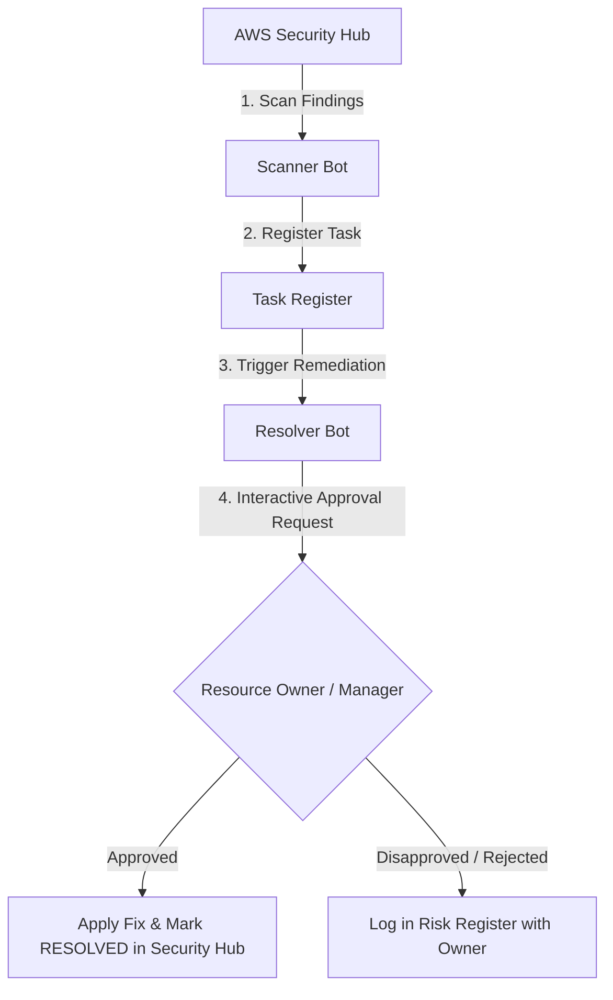

> ⚠️ **Region Reminder:** Select AWS Region **us-west-2 (Oregon)** and select the AWS Security Hub service.

**Estimated Time:** 15 minutes

---

## Overview

Use an Optimus template to build Security Hub finding remediation with a process that doesn't stop at recommendation but manages risk through federated risk owner approval. You will configure the autonomous orchestrator (Optimus) to define the remediation operation flow, update tools and agent skills, understand the scheduled vs. event-driven repetitive process with the Scanner/Resolver architecture, observe Task and Risk Register tracking, and test interactive approvals and escalations.

---

## Step 1: Navigate to Optimus

1. From the autobotAI top navigation, click the **OPTIMUS** button to open the Optimus panel.

   

---

## Step 2: Launch the Security Hub Remediation Template

Instead of building everything manually, we use a pre-created template that instructs Optimus on how to build the complete Security Hub remediation workflow.

1. In the Optimus chat window, select the template card named **Security Hub Findings Remediation with Escalation**.
2. Click to select the template. Optimus will automatically load the required skills, tools, system prompt, and user prompt into the chat area.
3. Click the **settings (⚙️)** icon visible above the prompt box to open the configuration panel.
4. Under **AI Model → Provider & Integration**, configure the following:
   - **AI Provider:** `aws bedrock`
   - **Integration Account:** your Bedrock integration (e.g. `test-aws-bedrock-us-west-2`)
   - **Model:** `global.anthropic.claude-opus-4-6-v1`

   

5. In the same config tab, verify the **Model Parameters**:
   - **Temperature:** `0.70`
   - **Max Iterations:** toggle on **No limit** (required for complex action building)

6. Go to the **Knowledge** tab and check which skills the template has loaded into Optimus.

7. Before sending, review the **user prompt** that has been automatically loaded into the prompt box by the template. Update the following variables to match your environment:
   - **AWS Region:** `us-west-2`
   - **AWS Integration Name:** the exact name of your AWS Integration (e.g. `test-aws`)
   - **SES Integration Name:** the exact name of your SES Integration (e.g. `test-aws-ses-us-west-2`)
   - **Reminder Timeout:** `2 minutes` (accelerated timeout for the lab)
   - **Escalation Timeout:** `3 minutes` (accelerated timeout for the lab)

8. Once all values are confirmed and updated, press **Enter** or click **Send** to begin the workflow.

---

## Step 3: Tool Governance & Action Enablement (Fallback Step)

> [!NOTE]
> **Tool Governance as a Fallback:** This step is required **only if** Optimus drafts new custom actions during workflow creation and pauses for your authorization. If the required tools are already active in your environment, Optimus will complete creation automatically without pausing.

1. If Optimus pauses for authorization during action creation, click the configuration link in the chat bubble or navigate directly to the **Tools** menu.
2. Select the appropriate tab (**AWS**, **SES**, or **Python**), locate the generated tool, toggle the action to enabled, and click **Save**.

   
   

3. Reply to Optimus in the chat thread confirming that the actions are active.

---

## Step 4: Understand the 2-Bot Architecture

Optimus automatically provisions a two-bot architecture designed for automated scanning, task management, risk governance, and interactive approvals.

### Component Roles

- **Scanner Bot:** Runs on a scheduled trigger or on-demand to query AWS Security Hub for active findings (e.g. unencrypted SQS queues, open Security Group ingress ports). When non-compliant findings are detected, it creates entries in the **Task Register**.
- **Task Register:** Acts as the central task queue for all identified security issues.

  
  

- **Resolver Bot:** A listener bot that monitors the Task Register. For non-disruptive fixes (like enabling SQS encryption), it remediates immediately. For disruptive changes (like closing ingress ports), it sends interactive approval cards to the resource owner.
- **Risk Register & Accountability:** If a resource owner or manager **disapproves / rejects** a proposed fix (for example, keeping a port open due to legacy operational needs), the Resolver bot logs that item in the **Risk Register** under that specific person's name.

  > [!IMPORTANT]
  > **Accountability in "Crashout" Scenarios:**
  > If a security incident or breach ("crashout scenario") occurs in the future because of an unmitigated vulnerability, auditing the **Risk Register** immediately reveals who rejected the remediation and accepted the risk on behalf of the business.

  
  

---

## Step 5: Access the DeepAgent Bot Execution

1. Once bot creation completes, Optimus automatically enables and triggers the created bots for you. A **clickable Bot Node Card** displaying the bot name will appear in the chat window.

   

2. Click the node card (or navigate via **Bot Execution** in the menu and click **Open**) to jump directly into the **DeepAgent Chat Thread** to monitor the execution.

---

## Step 6: Handling Notifications & Escalations (Choose an Option)

Once the Scanner bot logs tasks, non-disruptive items are fixed automatically. For disruptive fixes (e.g., locking down Security Group ingress ports), the Resolver bot emails an approval link to the resource owner (`engineer@company.com`).

Depending on what capability you want to test in this workshop, **choose one of the following paths**:

### Option A: Ignore Notifications (Test Manager Escalation)
1. **Ignore the initial email notification** sent to `engineer@company.com`.
2. After **2 minutes**, a reminder email will be sent. **Ignore it as well.**
3. After **5 minutes** total (when the SLA expires), the bot automatically escalates and sends the **Escalation Email** to `manager@company.com`.

   

4. Navigate to **Task Register** from the main menu — you will see the task status updated to **ESCALATED**.
5. Open the escalation email as `manager@company.com`, click the link, and proceed to **Step 7**.

---

### Option B: Respond Immediately (Skip Escalation)
1. Open the initial notification email sent to `engineer@company.com` (or open the DeepAgent chat thread directly).
2. Click the chat thread link and proceed directly to **Step 7**.

---

## Step 7: Interactive Approvals, Disapprovals & Risk Register Tracking

Inside the **DeepAgent Chat Thread**, the bot displays interactive **Approval Cards** directly in the chat stream.

You can choose how to handle the approval cards based on what outcome you want to explore:

### Path 1: Approve All Findings
1. Click **Approve** on each approval card.
2. The bot applies all approved fixes, updates the corresponding findings to `RESOLVED` in AWS Security Hub, and sends a summary report.

   

---

### Path 2: Approve Some & Disapprove Some (Test Risk Register)
1. Click **Approve** on low-impact findings and **Disapprove / Reject** on disruptive findings (e.g., keeping an ingress port open for operational needs).
2. For approved findings, the bot applies the fix and marks them `RESOLVED`.
3. For **disapproved** findings, the bot **does not leave them unmonitored**. Instead, it logs the unmitigated finding into the **Risk Register**, tagging the decision with the resource owner's identity for audit accountability.
4. Navigate to **Risk Register** from the main menu to confirm that the rejected finding appears as an accepted risk under the owner's name.

---

### Path 3: Disapprove / Reject All
1. Click **Disapprove** on all approval cards.
2. The bot leaves the cloud resources untouched, logs all findings into the **Risk Register** under the owner's name, and sends a risk acceptance confirmation report.

---

## Step 8: Verify Findings in AWS Security Hub

1. Log into your [AWS Security Hub Console](https://console.aws.amazon.com/securityhub/home).
2. Browse to **Findings** and verify that approved findings are updated to `PASSED` / `RESOLVED`.

> [!TIP]
> Filter by **Workflow Status = RESOLVED** and **Record State = ARCHIVED** to quickly locate the findings processed by the bot.

---

**Next:** Proceed to [Module 5.3: Implementing Automated Remediation with autobotAI (Library Import)](../5.3/)

---

## ✅ Success Criteria

You've completed this section when:
- [ ] Optimus default settings and AI model parameters are configured
- [ ] Security Hub remediation template is launched with environment variables
- [ ] Scanner and Resolver bots are automatically created and executed
- [ ] Tested notification options and manager escalation timeout
- [ ] Approved or disapproved findings via interactive chat approval cards
- [ ] Verified tracked tasks and risk register entries
- [ ] Verified resolved findings in the AWS Security Hub console

---

## Troubleshooting

### Issue: Optimus pauses and asks for action authorization
**Solution:** This is expected tool governance. Follow the link to the Tools menu, enable the generated action, click Save, and reply to Optimus to resume.

### Issue: Escalation email not received
**Solution:** Ensure the 5-minute escalation SLA timeout has fully elapsed and verify that your SES integration email addresses are properly configured.
